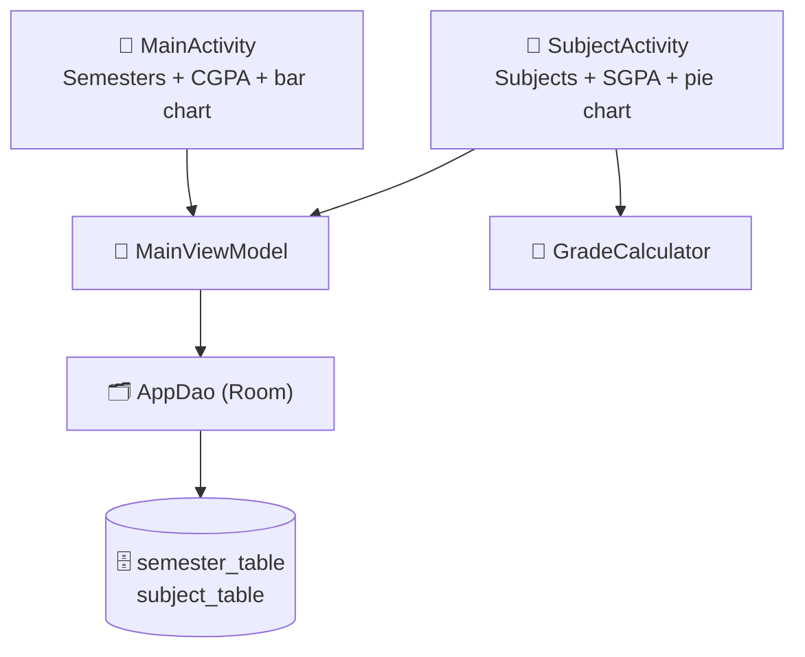

<div align="center">

# 🎓 CGPA Tracker — Semester & CGPA Calculator for Android

**An offline Android app that works out each subject's grade, every semester's SGPA and your overall CGPA from your marks, for colleges that don't calculate it for you.**


-3DDC84?logo=android&logoColor=white)


[Overview](#-overview) • [Features](#-features) • [Grading Rules](#-grading-rules) • [How CGPA Is Calculated](#-how-sgpa-and-cgpa-are-calculated) • [Tech Stack](#-tech-stack) • [Getting Started](#-getting-started)

</div>

---

## 📋 Overview

Many colleges publish marks per subject but leave students to work out their own SGPA and CGPA. **CGPA Tracker** does the maths for you. Add your semesters and subjects, enter your marks, and the app instantly shows each grade, each semester's SGPA and your running CGPA, with charts.

All data stays on your phone in a local database, so it works with no internet.

---

## ✨ Features

### 📚 Semesters
- Add, rename and delete semesters (for example "Semester 1")
- Each semester card shows its **SGPA**
- Deleting a semester also deletes its subjects (with a confirmation dialog)

### 📖 Subjects
- Add subjects with **name** and **credits**
- Choose **Theory** or **Practical** — each has its own marks entry
- Mark a subject as **Absent**
- Edit or delete any subject
- Final marks, **grade** and **grade point** are worked out automatically

### 📊 Results & charts
- Big **CGPA** display on the home screen
- **Bar chart** of SGPA across all semesters (scale 0–10)
- **Pie chart** of grade points per subject inside each semester
- Everything updates the moment you change a mark

### 💾 Storage
- Local **Room (SQLite)** database — private to your phone and works offline

---

## 📏 Grading Rules

### Marks entry

| Subject type | Marks you enter | Final marks (out of 100) |
|---|---|---|
| **Theory** | Mid Sem (25) + Internal (25) + End Sem (100) | Mid + Internal + **End Sem ÷ 2** |
| **Practical** | Internal Assessment (50) + End Sem (50) | Internal + End Sem |

### Fail and absent rules

| Case | Result |
|---|---|
| Absent | Grade **NA**, 0 grade points |
| Theory with End Sem **below 35** (out of 100) | Grade **F** |
| Practical with End Sem **below 18** (out of 50) | Grade **F** |

### Grade table

| Final marks | Grade | Grade point |
|:---:|:---:|:---:|
| 80 and above | **O** | 10 |
| 70 – 79 | **A+** | 9 |
| 60 – 69 | **A** | 8 |
| 55 – 59 | **B+** | 7 |
| 50 – 54 | **B** | 6 |
| 45 – 49 | **C** | 5 |
| 40 – 44 | **P** | 4 |
| Below 40 / fail / absent | **F** / **NA** | 0 |

> These rules are written in `GradeCalculator.kt`. If your college uses a different scheme, change them there.

---

## 🧮 How SGPA and CGPA Are Calculated

**SGPA** (credit-weighted):

```
SGPA = Σ (grade point × credits) ÷ Σ credits
```

**CGPA** (the average of your semester SGPAs):

```
CGPA = (SGPA₁ + SGPA₂ + … + SGPAₙ) ÷ number of semesters
```

---

## 🛠️ Tech Stack

| Layer | Technology |
|---|---|
| **Language** | Kotlin |
| **UI** | Android Views (XML) with Material Components, RecyclerView |
| **Architecture** | MVVM — `ViewModel` + `LiveData` |
| **Database** | Room (SQLite), with a foreign key from subjects to semesters |
| **Charts** | MPAndroidChart |
| **Min / target SDK** | 24 / 36 |

---

## 🏗️ Architecture



### Project structure

```
CGPA_Tracker/
└── app/src/main/
    ├── java/com/cgpatracker/app/
    │   ├── MainActivity.kt          # Semester list, CGPA, SGPA bar chart
    │   ├── MainViewModel.kt         # Data actions
    │   ├── data/
    │   │   ├── AppDatabase.kt
    │   │   ├── dao/AppDao.kt
    │   │   └── entity/              # Semester, Subject
    │   ├── ui/
    │   │   ├── SubjectActivity.kt   # Subjects, SGPA, grade pie chart
    │   │   ├── SemesterAdapter.kt
    │   │   └── SubjectAdapter.kt
    │   └── utils/GradeCalculator.kt # Marks → grade → grade point
    └── res/layout/                  # Screens and dialogs
```

---

## 🚀 Getting Started

### Prerequisites

- **Android Studio** (latest stable)
- An Android phone or emulator running **Android 7.0 (API 24)** or newer

### Run

```bash
git clone https://github.com/IshanPatel1912/CGPA_Tracker.git
```

1. Open the folder in **Android Studio** and let Gradle sync.
2. Connect a device or start an emulator.
3. Click **Run ▶**.

### Build an APK

**Build → Build Bundle(s) / APK(s) → Build APK(s)**, or:

```bash
./gradlew assembleDebug
```

The APK is created in `app/build/outputs/apk/debug/`.

### Using the app

1. Tap **+** to add a semester.
2. Tap the semester, then **+** to add each subject with its credits and marks.
3. Your SGPA and the home-screen CGPA update automatically.

---

## 🗺️ Roadmap

- [ ] Export the result sheet as a PDF
- [ ] Target-CGPA planner ("what do I need next semester?")
- [ ] Customisable grading scheme in settings
- [ ] Credit-weighted CGPA option
- [ ] Backup and restore

---

## 👤 Author

**Ishan Patel** — Undergraduate student, Pandit Deendayal Energy University (PDEU)

[](https://github.com/IshanPatel1912)

---

<div align="center">

**Built with ❤️ for students**

[🔝 Back to top](#-cgpa-tracker--semester--cgpa-calculator-for-android)

</div>
